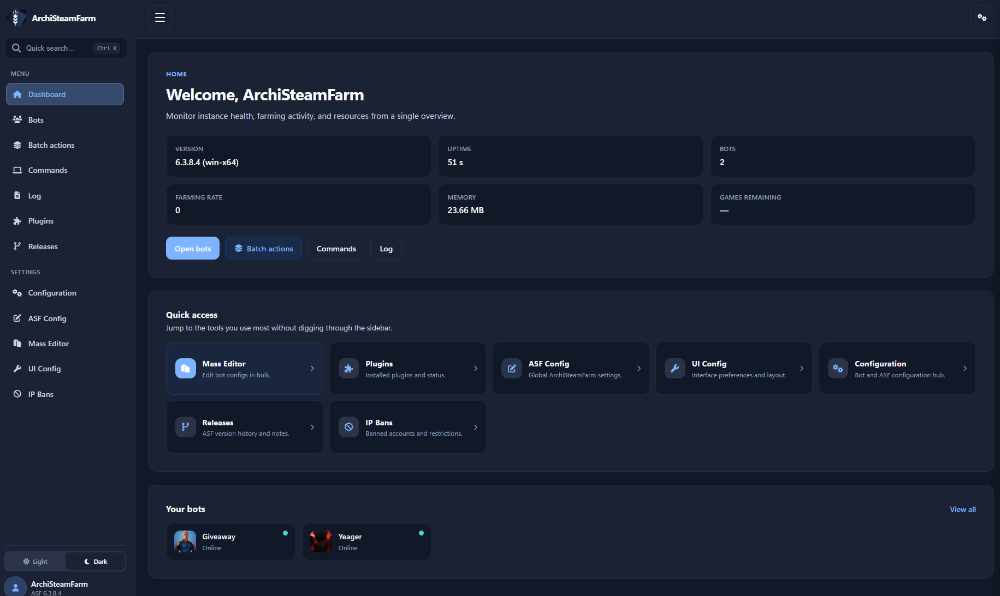
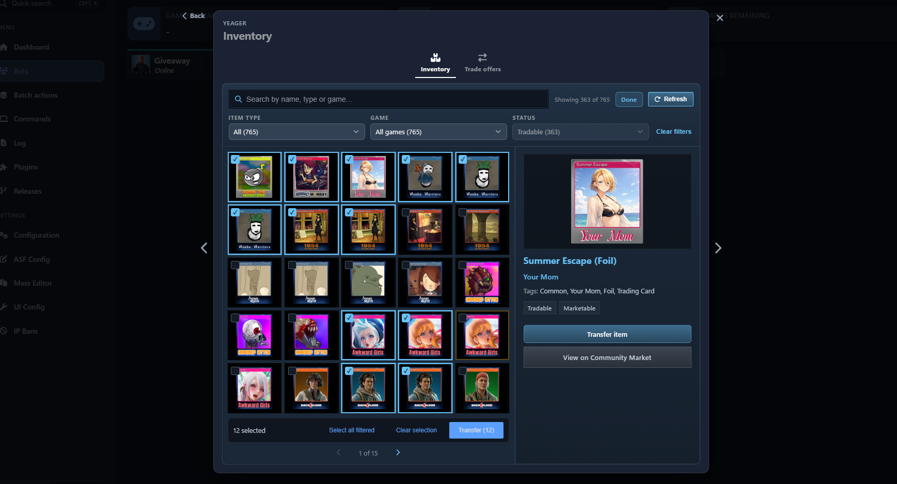
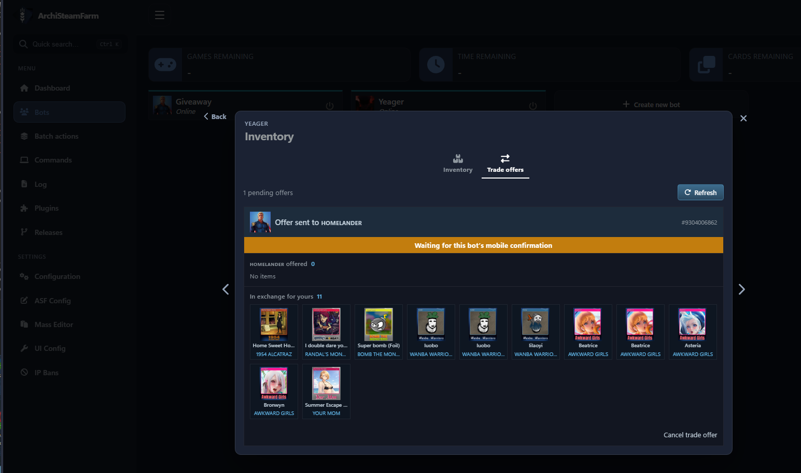
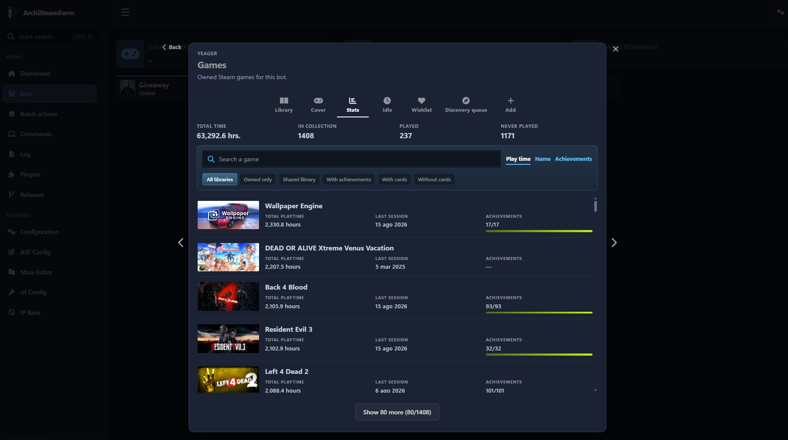
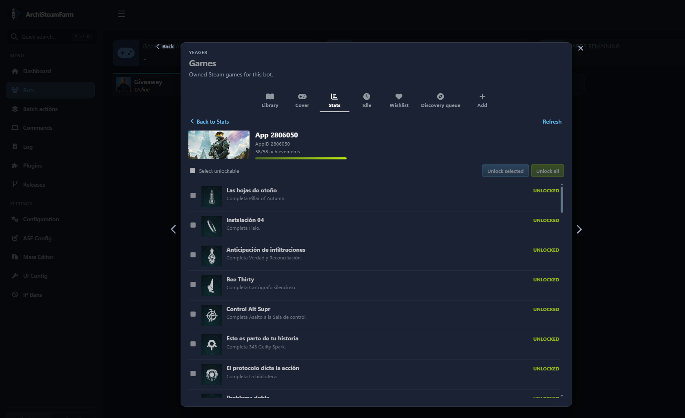
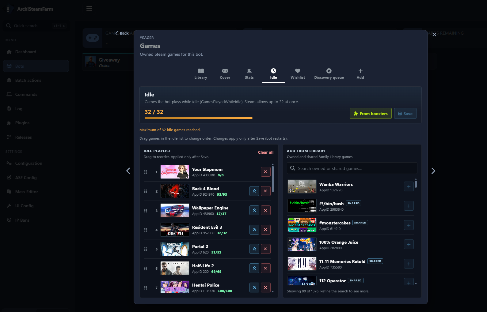
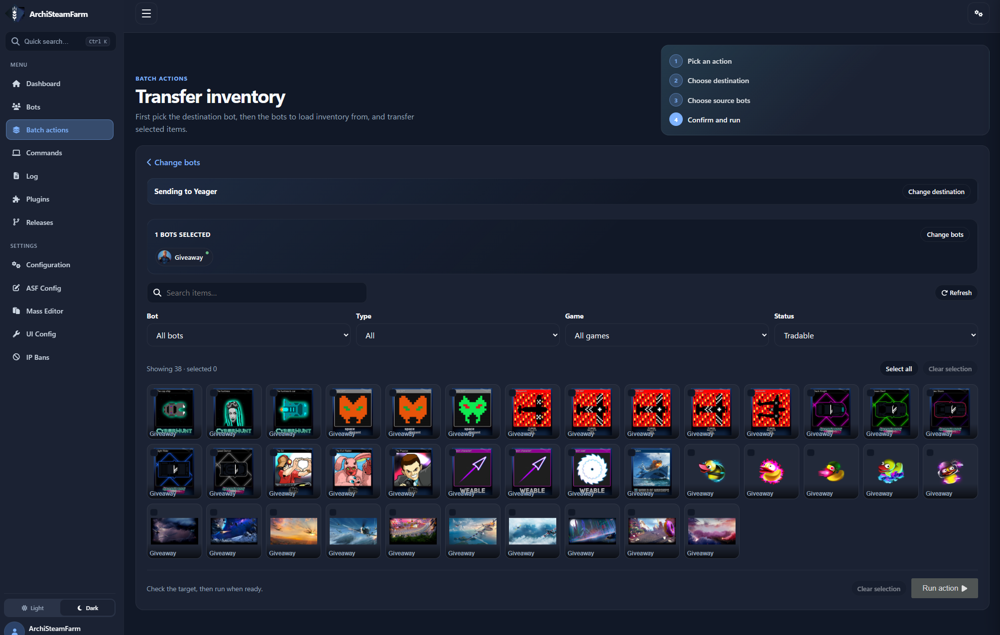

<p align="center">
  
</p>

<h1 align="center">ASF-ui</h1>

<p align="center">
  Interfaz web personalizada de <strong>ArchiSteamFarm</strong> (bot social, multi-action y cambios).<br/>
  Fork de la UI oficial — no es un fork del núcleo de ASF.
</p>

<p align="center">
  <a href="README.md">English</a> · <strong>Español</strong>
</p>

<p align="center">
  <a href="https://github.com/Jeremias0618/ASF-ui">
    
  </a>
  <a href="https://github.com/JustArchiNET/ASF-ui">
    
  </a>
  
  
  <a href="https://github.com/Jeremias0618/ASF-ui/releases">
    
  </a>
</p>

<p align="center">
  <a href="https://hits.sh/github.com/Jeremias0618/ASF-ui/">
    
  </a>
</p>

---

> [!IMPORTANT]
> Esto **no** es el proyecto oficial [JustArchiNET/ASF-ui](https://github.com/JustArchiNET/ASF-ui). Licencia Apache-2.0 del upstream. El soporte es responsabilidad del mantenedor del fork.

> [!IMPORTANT]
> Bot Social (amigos, comunidad, juegos, wishlist, transferencia de inventario) requiere el plugin **[ASFBotSocial](https://github.com/Jeremias0618/ASF-Plugin)**. La UI de stock de ASF (`www/`) no incluye esas pantallas.

## Asistente de inicio de sesión en Steam (`/bot/<nombre>/login`)

El asistente usa solo el **IPC oficial de ASF** (`Bot`, `Bot/Input`, `Bot/Start`, `Bot/Stop`). Funciona con ASF de stock y **no** necesita `ASFBotSocial`. El éxito solo se muestra cuando ASF informa `IsConnectedAndLoggedOn`.

La tabla distingue lo que admite la API de lo que se probó de principio a fin (ASF oficial 6.3.10.3, no headless, con cuentas de prueba que no pueden iniciar sesión).

| Caso | Lo que admite la API | Probado de principio a fin | Dónde se completa |
| --- | --- | --- | --- |
| Crear / iniciar / detener el bot | Sí | Sí | Web |
| Elegir **QR** o **credenciales** antes de iniciar un bot detenido (`Input QrCodeLogin = Y/N`) | Sí, solo con ASF no headless y si ASF no está ya preguntando | Sí: `Y` muestra el QR en la web, `N` sigue por credenciales | Web |
| **Crear nuevo bot** con *Escanear QR*: guarda el bot temporalmente detenido (`Enabled: false`), con `SteamLogin` solo si se escribió (nunca la contraseña), envía `QrCodeLogin = Y` y lo inicia; cuando Steam confirma la conexión se guarda el *Estado del bot* elegido, tras pedir el usuario de Steam si falta | Sí, solo con ASF no headless | Sí: el QR aparece en la web sin escribir `Y` en la consola, en ASF oficial sin `ASFBotSocial`; si falla el arranque el bot se conserva y *Reintentar* lo reutiliza. Los pasos posteriores a la conexión se ejercitaron con una señal de «conectado» **simulada** (y SteamID simulados): el paso del usuario, el guardado final (la config termina con `Enabled` + `SteamLogin`), un guardado fallido con reintento, *Deshabilitado* (se guarda y ASF detiene el bot) y el aviso de cuenta duplicada. Tras reiniciar ASF, el bot habilitado arranca solo y el deshabilitado no. **No probado**: un QR real aprobado, un reinicio que reutilice un token guardado sin preguntar de nuevo, un QR aprobado por otra cuenta, ni dos bots con una misma cuenta real | Web |
| Enviar usuario y contraseña por adelantado (`Login`, `Password`) | Sí (se guardan en memoria, nunca en disco) | Sí: el intento arranca; la cuenta usada era inválida | Web |
| Responder una pregunta `Y/N` que ASF **ya tiene abierta** en su consola | No (ASF la lee de la consola) | Sí: el asistente la detecta y no ofrece botones | **Consola de ASF** (o cancelar y volver a elegir desde la web) |
| Código de Steam Guard por correo, código 2FA móvil, código de respaldo, PIN parental | Sí, cuando ASF lo pide (o enviado por adelantado) | No: requiere una cuenta válida | Web (`Bot/Input`) |
| QR en modo headless / servicio | ASF nunca pregunta; usa credenciales | No | Consola de ASF / configuración |
| Aprobación móvil o código (`Y/N`) | Solo es una pregunta de consola | No | **Consola de ASF** |
| La aprobación en sí, cuando Steam la ofrece | Sí | No | App móvil de Steam; el asistente sigue consultando |
| Inicio de sesión válido completo hasta «Conectado» | Sí | **No** | - |
| Cryptkey | No | No | Consola de ASF / argumentos de arranque |

Notas sobre la elección de método:

- Solo se muestra con el bot detenido y ASF no headless. Si ASF ya está esperando en su consola, el asistente lo indica y la pregunta debe responderse allí.
- Una respuesta por adelantado es de **un solo uso**: ASF la consume y, si el inicio falla, puede volver a preguntar en su consola. Enviarla antes no equivale a contestar una pregunta que ya está abierta.
- En *Crear nuevo bot*, el *Estado del bot* se muestra con ambos métodos y queda en *Habilitado* por defecto («Inicia el bot automáticamente al arrancar ASF»). Iniciar ahora y arrancar automáticamente son decisiones distintas: al crear, el bot se guarda temporalmente detenido (`Enabled: false`), porque guardarlo habilitado haría que ASF lo arrancara antes de recibir la elección del QR. El estado elegido se conserva (en `sessionStorage`, sin secretos) y ASF-ui lo guarda cuando ASF informa que el bot está conectado y con sesión iniciada. Guardar la configuración hace que ASF detenga y vuelva a iniciar ese bot (una breve reconexión); con `UseLoginKeys` activo y una sesión aprobada, ASF reutiliza el token guardado en lugar de pedir otro QR. Si ese guardado final falla, el asistente indica que la sesión se inició pero el estado no se guardó y ofrece *Reintentar guardado*. Si el usuario eligió *Deshabilitado*, no se guarda nada más.
- En modo QR el formulario conserva *Usuario de Steam* (opcional) y oculta *Contraseña de Steam*, que nunca se envía. ASF recibe el nombre de la cuenta al aprobar el QR y lo usa solo en memoria; el IPC oficial no lo devuelve y `GET Bot` nunca devuelve `SteamLogin`. Por eso, si se omitió, ASF-ui muestra un paso breve *Guardar usuario de Steam* cuando el bot ya está conectado (solo el nombre de inicio de sesión de Steam, no el nombre del bot, el alias del perfil ni el SteamID) y lo guarda junto con el *Estado del bot* elegido; sin él, el bot no puede iniciar sesión de nuevo tras reiniciar ASF. Si el usuario sale antes, el bot sigue conectado y se avisa de que su configuración para reconectar sigue pendiente (el paso vuelve al reabrir la ventana, durante 12 horas en la misma pestaña). Si el usuario escribió el usuario antes, ASF comprueba que el QR lo apruebe esa cuenta. Con *Deshabilitado*, guardar el usuario hace que ASF detenga el bot, como implica ese estado.
- Detección de cuentas duplicadas (parcial): no impide los intentos con una cuenta repetida. Actúa después de que el bot nuevo se autentica y solo cuando ASF expone el SteamID64 de ambos bots (se compara como cadena, ignorando el propio bot y los valores vacíos o `0`). Si encuentra una coincidencia, el asistente indica *Esta cuenta de Steam ya está asociada al bot X*, no habilita el bot nuevo ni guarda nada, deja intacto el bot existente y ofrece *Detener este bot* o *Eliminar bot nuevo* (que pide confirmación). **Límites:** un bot detenido o desconectado no tiene SteamID en ASF, así que no se puede comparar; Steam puede haber cerrado ya una de las dos sesiones antes del aviso; y solo se revisan los bots creados desde este formulario.
- El aviso *Configurado para iniciar al arrancar ASF* significa que el usuario se guardó con *Habilitado* y *Usar claves de acceso* activos. ASF-ui no puede comprobar que el usuario ingresado tras el QR corresponda a la cuenta que lo aprobó (el asistente pide el nombre de inicio de sesión de esa cuenta), ni que ASF tenga un token reutilizable.
- El campo *Nombre* es obligatorio al crear y al editar (vacío o solo espacios bloquea los botones y el envío; los nombres reservados y duplicados se siguen rechazando). Si ASF es headless, la opción QR queda deshabilitada y el formulario indica el motivo.
- `N` solo avanza si el bot ya tiene credenciales: guardadas en su configuración, o enviadas por adelantado desde el formulario.
- ASF no cancela una sesión QR al detener un bot, así que puede seguir publicando un desafío viejo. Si eliges credenciales, el asistente ignora cualquier QR publicado durante ese intento.

Nada de esto lee logs, escribe en stdin ni modifica ASF.

## Mis reseñas (`/bot/<nombre>/reviews`)

Reseñas escritas por la propia cuenta de Steam del bot, con un editor para publicarlas y editarlas. Requiere el plugin **ASFBotSocial**: `reviews.own.read` para leer, `reviews.own.edit` para editar y `reviews.own.publish` para publicar (se anuncian por separado). Sin el plugin aparece el aviso de instalación habitual; con una DLL antigua la pantalla indica que hay que actualizarlo y, sin las capacidades de escritura, las acciones vuelven a *Gestionar en Steam* / la página de la tienda.

- **Publicadas:** 10 por página con un pie `Anterior · 1 · 2 · 3 · … · Siguiente` y «Mostrando 1–10 de 51». Al abrir la ventana solo se pide la página que se está viendo; el buscador carga el resto de páginas bajo demanda y filtra **todas** las reseñas, no solo las diez visibles. Portada, título, la recomendación del autor (*Recomiendo* / *No recomiendo*), fecha y extracto. Al abrir una se carga el texto completo, los contadores *Útil* / *Divertida* que Steam devolvió y sus premios; la recomendación del autor nunca se mezcla con las reacciones recibidas.
- **Para reseñar:** juegos de la biblioteca (en propiedad) sin reseña conocida de la cuenta, de 10 en 10. Se filtra toda la biblioteca con el buscador antes de paginar y ya no hay un tope fijo. Son solo **candidatos**: Steam confirma la elegibilidad al publicar, y el aviso se mantiene mientras la lista de reseñas publicadas esté incompleta.
- La pestaña, la búsqueda y la página se conservan al volver de un detalle; cambiar la búsqueda vuelve a la página 1.
- **Editor (publicar / editar):** un único formulario para ambos flujos: *Recomiendo* / *No recomiendo* (obligatorio al publicar), el texto (8000 caracteres, con contador), el idioma de la reseña al publicar y *Publicar reseña* / *Guardar cambios*. Al editar se carga el texto tal como está guardado y la recomendación actual; cambiar la recomendación avisa de que Steam borra las valoraciones recibidas y pide confirmación. Si el envío falla se conserva el borrador, un doble clic envía una sola vez y cerrar con cambios sin guardar pregunta antes. Solo se muestra «guardada» cuando el plugin confirma que Steam la tiene; al publicar se refresca *Publicadas* y el juego sale de *Para reseñar*; al editar se actualizan la tarjeta y el detalle en el sitio sin perder la página. Si el juego ya tiene reseña, publicar ofrece abrirla para editarla.
- Los contadores que Steam no devolvió se omiten (nunca se muestran como `0`); *No útil* no lo expone Steam y la pantalla lo indica. El texto de las reseñas se muestra siempre como texto plano. Eliminar no está disponible: usa *Gestionar en Steam*.

Qué se probó realmente (2026-11-26): contra ASF 6.3.10.3 con la DLL nueva y el bot Yeager conectado, desde la UI compilada — página 1 / página 6 de 51 reseñas, búsqueda fuera de la página 1 (encontrada en la 6), borrar la búsqueda y volver a la página 1, conservar página y búsqueda al abrir un detalle, la lista *Para reseñar* (382 candidatos, 39 páginas, última página, búsqueda), abrir el editor con el texto y la recomendación guardados, un guardado fallido (servidor caído) que conservó el borrador, un doble clic que produjo un único `PUT`, la confirmación de cambios sin guardar, una edición real del texto de una reseña existente confirmada por relectura y restaurada después, y el formulario de publicar abierto y cancelado. **No se probó:** publicar de verdad una reseña nueva en Steam, cambiar la recomendación de una reseña existente y, en esta ronda, las pantallas de respaldo con una DLL sin las capacidades de escritura. El contrato está en el README del plugin.

## Vista previa

<table>
  <tr>
    <td align="center"><br/>Dashboard</td>
    <td align="center"><br/>Inventario</td>
  </tr>
  <tr>
    <td align="center"><br/>Ofertas de intercambio</td>
    <td align="center"><br/>Juegos — stats</td>
  </tr>
  <tr>
    <td align="center"><br/>Logros</td>
    <td align="center"><br/>Idle</td>
  </tr>
  <tr>
    <td align="center" colspan="2"><br/>Acciones por lote — transferir inventario</td>
  </tr>
</table>

## Instalación (release compilado)

Los usuarios **no** necesitan Node.js. Descarga el paquete `www` ya compilado desde [GitHub Releases](https://github.com/Jeremias0618/ASF-ui/releases) (`ASF-ui.zip`).

1. Detén ArchiSteamFarm (o cierra la pestaña de la UI).
2. Descarga **ASF-ui.zip** del último release.
3. Extrae el ZIP en la carpeta **`www/`** de ASF (junto a `ArchiSteamFarm.exe`), reemplazando los archivos existentes.
4. Arranca ASF y abre `http://localhost:1242` (recarga forzada una vez).

> [!WARNING]
> Una actualización oficial de ASF puede pisar `www/`. Tras actualizar ASF, vuelve a extraer esta UI (o desactiva el auto-update de la UI si mantienes un `www/` personalizado).

### CLI

Detén ASF primero. Sustituye `RUTA_DE_TU_ARCHISTEAMFARM` por la carpeta que contiene `ArchiSteamFarm.exe` y `www/`, y desde ahí descarga y extrae.

> [!NOTE]
> En PowerShell de Windows **no** uses `curl` ni `unzip` (son de Linux; `curl` ahí es un alias de `Invoke-WebRequest`). Copia el bloque **Windows**.

**Windows (PowerShell)**

```powershell
cd "RUTA_DE_TU_ARCHISTEAMFARM"

curl.exe -L -o ASF-ui.zip "https://github.com/Jeremias0618/ASF-ui/releases/latest/download/ASF-ui.zip"
Expand-Archive -Path "ASF-ui.zip" -DestinationPath "www" -Force
Remove-Item "ASF-ui.zip"
```

**Linux / macOS**

```bash
cd "RUTA_DE_TU_ARCHISTEAMFARM"

curl -L -o ASF-ui.zip "https://github.com/Jeremias0618/ASF-ui/releases/latest/download/ASF-ui.zip"
unzip -o ASF-ui.zip -d www
rm ASF-ui.zip
```

Inicia ASF y abre `http://localhost:1242`.

## Relacionado

| Pieza | Repo |
|-------|------|
| Plugin (obligatorio para Bot Social) | https://github.com/Jeremias0618/ASF-Plugin |
| Núcleo ASF | https://github.com/JustArchiNET/ArchiSteamFarm |
| UI upstream | https://github.com/JustArchiNET/ASF-ui |

## Licencia y créditos

- Upstream: [JustArchiNET/ASF-ui](https://github.com/JustArchiNET/ASF-ui) — Apache-2.0
- Fork y cambios Yeremi: [Jeremias0618/ASF-ui](https://github.com/Jeremias0618/ASF-ui)
