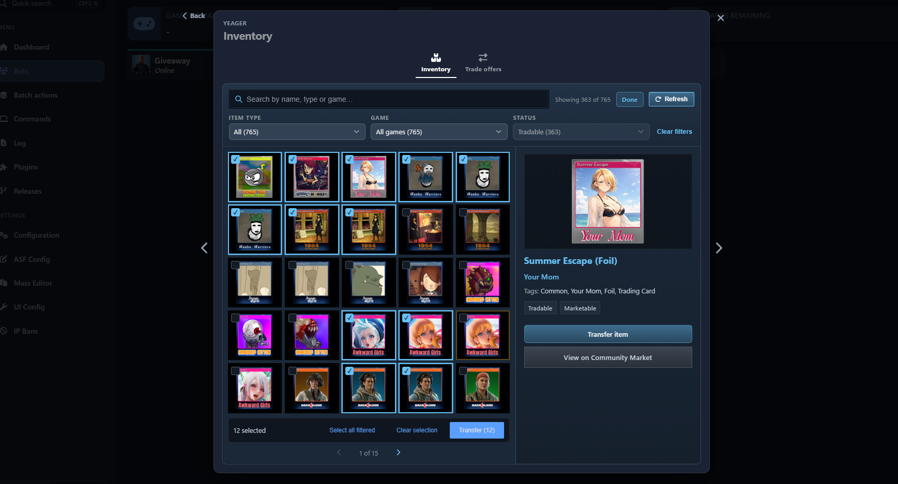
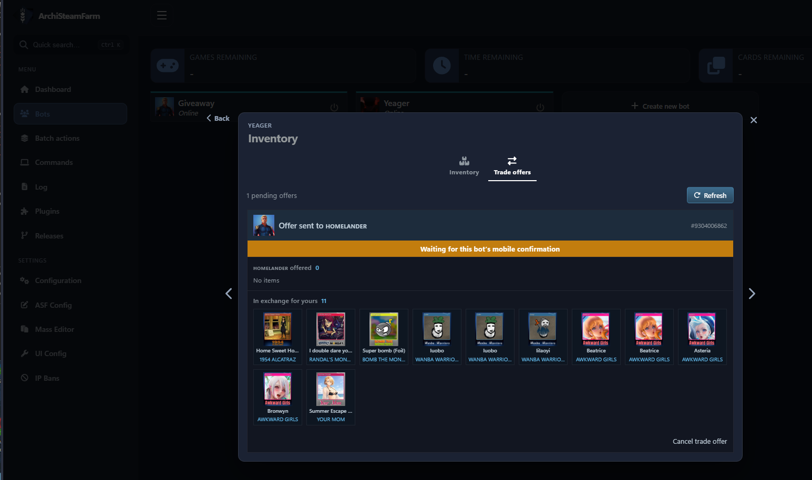
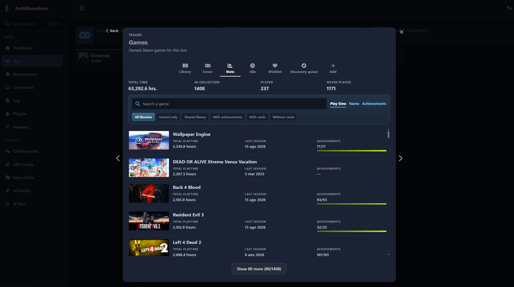
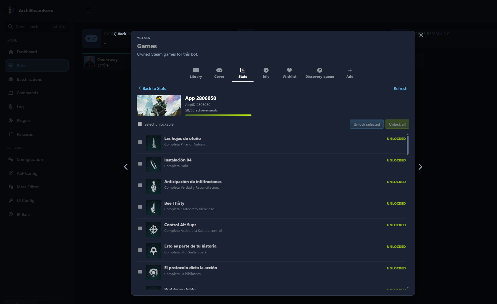
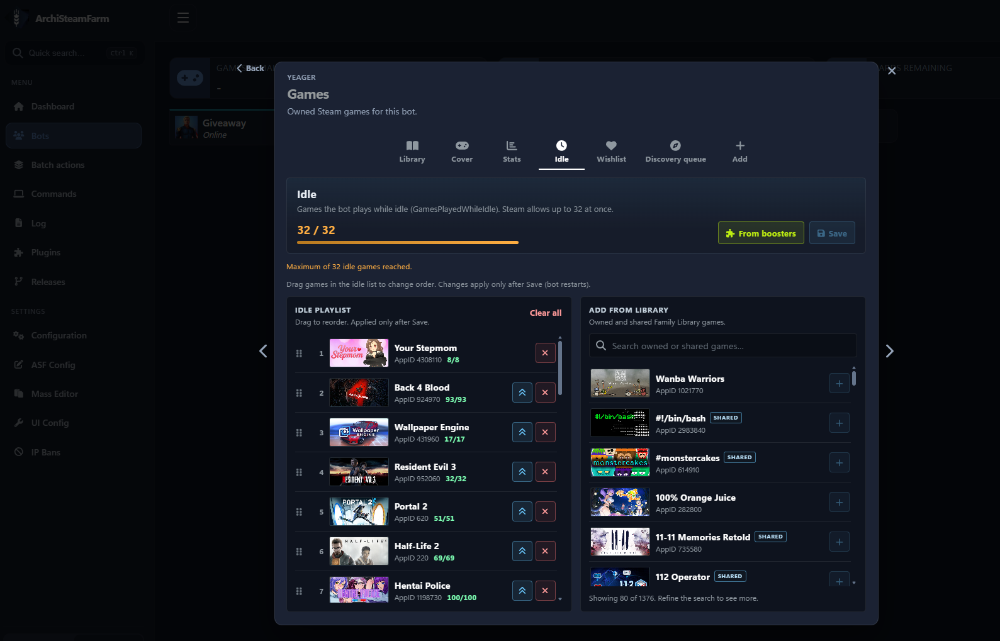
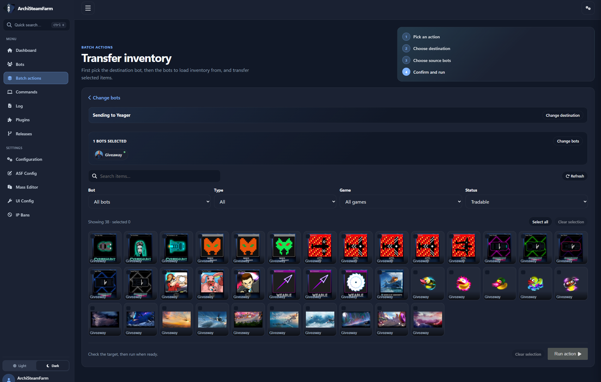

<p align="center">
  
</p>

<h1 align="center">ASF-ui</h1>

<p align="center">
  Custom <strong>ArchiSteamFarm</strong> web UI (bot social, multi-action, and customizations).<br/>
  Fork of the official interface — not a fork of the ASF core.
</p>

<p align="center">
  <strong>English</strong> · <a href="README-ESP.md">Español</a>
</p>

<p align="center">
  <a href="https://github.com/Jeremias0618/ASF-ui">
    
  </a>
  <a href="https://github.com/JustArchiNET/ASF-ui">
    
  </a>
  
  
  <a href="https://github.com/Jeremias0618/ASF-ui/releases">
    
  </a>
</p>

<p align="center">
  <a href="https://hits.sh/github.com/Jeremias0618/ASF-ui/">
    
  </a>
</p>

---

> [!IMPORTANT]
> This is **not** the official [JustArchiNET/ASF-ui](https://github.com/JustArchiNET/ASF-ui) project. License is Apache-2.0 from upstream. Support is the fork maintainer’s responsibility.

> [!IMPORTANT]
> Bot Social (friends, community, games, wishlist, inventory transfer) requires the companion plugin **[ASFBotSocial](https://github.com/Jeremias0618/ASF-Plugin)**. The stock ASF `www/` UI does not include those screens.

## Steam sign-in wizard (`/bot/<name>/login`)

The wizard only uses the **official ASF IPC** (`Bot`, `Bot/Input`, `Bot/Start`, `Bot/Stop`). It works with stock ASF and does **not** need `ASFBotSocial`. Success is shown only when ASF reports `IsConnectedAndLoggedOn`.

| Case | Stock ASF | Needs `ASFBotSocial` | Where it is finished |
| --- | --- | --- | --- |
| Create / start / cancel the bot | Yes | No | Web |
| Steam username, password, parental PIN (`Login`, `Password`, `SteamParentalCode`) | Yes | No | Web (`Bot/Input`) |
| Steam Guard e-mail code, mobile 2FA code, backup code | Yes (when ASF asks for it) | No | Web (`Bot/Input`) |
| Show a QR challenge ASF already generated | Yes | No | Scan it with the Steam app |
| QR vs credentials (`Y/N`) | Only in a non-headless console; headless never asks and uses credentials | No | **ASF console** |
| Mobile approval vs code (`Y/N`) | Only in a non-headless console | No | **ASF console** |
| Approval itself, once Steam offers it | Yes | No | Steam mobile app; the wizard keeps polling |
| Cryptkey | No | No | ASF console / startup arguments |

Answers to the two `Y/N` questions that ASF is already waiting for cannot be sent from the web: ASF reads them from its console, and neither the IPC nor the plugin interfaces expose that wait. When the wizard cannot continue it says which decision is pending. Nothing here parses logs, writes to stdin or modifies ASF.

## Preview

<table>
  <tr>
    <td align="center"><br/>Dashboard</td>
    <td align="center"><br/>Inventory</td>
  </tr>
  <tr>
    <td align="center"><br/>Trade offers</td>
    <td align="center"><br/>Games — stats</td>
  </tr>
  <tr>
    <td align="center"><br/>Achievements</td>
    <td align="center"><br/>Idle</td>
  </tr>
  <tr>
    <td align="center" colspan="2"><br/>Batch actions — transfer inventory</td>
  </tr>
</table>

## Install (compiled release)

End users do **not** need Node.js. Download the prebuilt `www` bundle from [GitHub Releases](https://github.com/Jeremias0618/ASF-ui/releases) (`ASF-ui.zip`).

1. Stop ArchiSteamFarm (or close the UI tab).
2. Download **ASF-ui.zip** from the latest release.
3. Extract it into the ASF **`www/`** folder (next to `ArchiSteamFarm.exe`), replacing existing files.
4. Start ASF and open `http://localhost:1242` (hard-reload once).

> [!WARNING]
> Official ASF updates can overwrite `www/`. After an ASF update, extract this UI again (or disable UI auto-update if you keep a custom `www/`).

### CLI

Stop ASF first. Replace `PATH_TO_YOUR_ARCHISTEAMFARM` with the folder that contains `ArchiSteamFarm.exe` and `www/`, then download and extract.

> [!NOTE]
> On Windows PowerShell do **not** use `curl` or `unzip` (those are Linux commands; `curl` there is an alias for `Invoke-WebRequest`). Copy the **Windows** block.

**Windows (PowerShell)** 

```powershell
cd "PATH_TO_YOUR_ARCHISTEAMFARM"

curl.exe -L -o ASF-ui.zip "https://github.com/Jeremias0618/ASF-ui/releases/latest/download/ASF-ui.zip"
Expand-Archive -Path "ASF-ui.zip" -DestinationPath "www" -Force
Remove-Item "ASF-ui.zip"
```

**Linux / macOS**

```bash
cd "PATH_TO_YOUR_ARCHISTEAMFARM"

curl -L -o ASF-ui.zip "https://github.com/Jeremias0618/ASF-ui/releases/latest/download/ASF-ui.zip"
unzip -o ASF-ui.zip -d www
rm ASF-ui.zip
```

Start ASF and open `http://localhost:1242`.

## Related

| Piece | Repo |
|-------|------|
| Plugin (required for Bot Social) | https://github.com/Jeremias0618/ASF-Plugin |
| ASF core | https://github.com/JustArchiNET/ArchiSteamFarm |
| Upstream UI | https://github.com/JustArchiNET/ASF-ui |

## License and credits

- Upstream: [JustArchiNET/ASF-ui](https://github.com/JustArchiNET/ASF-ui) — Apache-2.0
- Fork and Yeremi changes: [Jeremias0618/ASF-ui](https://github.com/Jeremias0618/ASF-ui)
