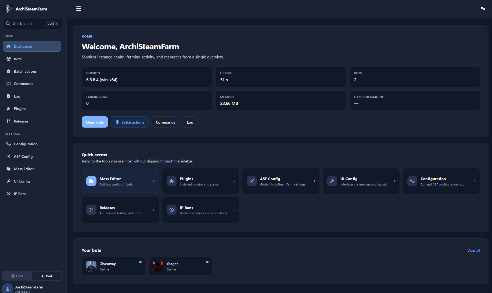

<p align="center">
  
</p>

<h1 align="center">ASF-ui</h1>

<p align="center">
  Custom <strong>ArchiSteamFarm</strong> web UI (bot social, multi-action, and customizations).<br/>
  Fork of the official interface — not a fork of the ASF core.
</p>

<p align="center">
  <strong>English</strong> · <a href="README-ESP.md">Español</a>
</p>

<p align="center">
  <a href="https://github.com/Jeremias0618/ASF-ui">
    
  </a>
  <a href="https://github.com/JustArchiNET/ASF-ui">
    
  </a>
  
  
  <a href="https://github.com/Jeremias0618/ASF-ui/releases">
    
  </a>
</p>

<p align="center">
  <a href="https://hits.sh/github.com/Jeremias0618/ASF-ui/">
    
  </a>
</p>

---

> [!IMPORTANT]
> This is **not** the official [JustArchiNET/ASF-ui](https://github.com/JustArchiNET/ASF-ui) project. License is Apache-2.0 from upstream. Support is the fork maintainer’s responsibility.

> [!IMPORTANT]
> Bot Social (friends, community, games, wishlist, inventory transfer) requires the companion plugin **[ASFBotSocial](https://github.com/Jeremias0618/ASF-Plugin)**. The stock ASF `www/` UI does not include those screens.

## Steam sign-in wizard (`/bot/<name>/login`)

The wizard only uses the **official ASF IPC** (`Bot`, `Bot/Input`, `Bot/Start`, `Bot/Stop`). It works with stock ASF and does **not** need `ASFBotSocial`. Success is shown only when ASF reports `IsConnectedAndLoggedOn`.

The table separates what the API admits from what was actually exercised end to end (official ASF 6.3.10.3, non-headless, with test accounts that cannot log in).

| Case | What the API admits | Tested end to end | Where it is finished |
| --- | --- | --- | --- |
| Create / start / stop the bot | Yes | Yes | Web |
| Choose **QR** or **credentials** before starting a stopped bot (`Input QrCodeLogin = Y/N`) | Yes, only in a non-headless ASF and when ASF is not already asking | Yes: `Y` shows the QR in the web, `N` goes on to credentials | Web |
| **Create new bot** with *Scan QR code*: saves the bot temporarily stopped (`Enabled: false`), with `SteamLogin` only if it was typed (never the password), sends `QrCodeLogin = Y` and starts it; once Steam confirms the connection the chosen *Bot status* is saved, after asking for the Steam username if it is missing | Yes, only in a non-headless ASF | Yes: the QR shows in the web with no `Y` typed in the console, on official ASF without `ASFBotSocial`; a failed start keeps the bot and *Try again* reuses it. The steps after the connection were exercised with a **simulated** "connected" signal (and simulated SteamIDs): the username step, the final save (config ends with `Enabled` + `SteamLogin`), a failed save with retry, *Disabled* (saved, ASF stops the bot), and the duplicated-account notice. After restarting ASF the enabled bot starts by itself and the disabled one does not. **Not tested**: a real approved QR, a restart that reuses a stored token without asking again, a QR approved by another account, or two bots on one real account | Web |
| Send username and password in advance (`Login`, `Password`) | Yes (kept in memory, never saved) | Yes: the attempt starts; the account used was invalid | Web |
| Answer a `Y/N` question that ASF **already has open** in its console | No (ASF reads it from the console) | Yes: the wizard shows it and offers no buttons | **ASF console** (or cancel and choose again from the web) |
| Steam Guard e-mail code, mobile 2FA code, backup code, parental PIN | Yes, when ASF asks (or sent in advance) | No: needs a valid account | Web (`Bot/Input`) |
| QR in headless / service mode | ASF never asks; it uses credentials | No | ASF console / config |
| Mobile approval vs code (`Y/N`) | Only a console question | No | **ASF console** |
| Approval itself, once Steam offers it | Yes | No | Steam mobile app; the wizard keeps polling |
| Full valid sign-in until "Connected" | Yes | **No** | - |
| Cryptkey | No | No | ASF console / startup arguments |

Notes on the method choice:

- It is only shown when the bot is stopped and ASF is not headless. If ASF is already waiting in its console, the wizard says so and the question must be answered there.
- A pre-answer is **single use**: ASF consumes it, and if the sign-in fails it may ask again in its console. Sending it in advance is not the same as answering a question that is already open.
- In *Create new bot*, *Bot status* is shown with both methods and defaults to *Enabled* («Starts the bot automatically when ASF starts»). Starting now and starting automatically are different decisions: while creating, the bot is saved temporarily stopped (`Enabled: false`), because saving it enabled would make ASF start it before the QR choice arrives. The status the user picked is kept (in `sessionStorage`, with no secrets) and ASF-ui saves it once ASF reports the bot as connected and logged on. Saving the config makes ASF stop and start that bot again (a brief reconnection); with `UseLoginKeys` on and an approved session, ASF reuses the saved token instead of asking for another QR. If that final save fails, the wizard says the session started but the status was not saved and offers *Retry saving*. If the user chose *Disabled*, nothing else is saved.
- In QR mode the form keeps *Steam username* (optional) and hides *Steam password*, which is never sent. ASF receives the account name when the QR is approved and uses it in memory only; the official IPC does not return it, and `GET Bot` never returns `SteamLogin`. So, if it was left out, ASF-ui shows a short *Save Steam username* step once the bot is connected (only the Steam sign-in name — not the bot name, the profile alias or the SteamID), and saves it together with the chosen *Bot status*; without it the bot cannot sign in again after ASF restarts. Leaving earlier keeps the bot connected and says that the reconnect configuration is still pending (the step comes back when the window is reopened, for 12 hours in the same tab). If the username was typed before, ASF checks that the QR is approved by that account. With *Disabled* chosen, saving the username makes ASF stop the bot, as that setting implies.
- Duplicated-account detection (partial): it does not prevent attempts with a repeated account. It runs after the new bot has authenticated and only when ASF exposes the SteamID64 of both bots (compared as strings, ignoring the bot itself and empty or `0` values). When it finds a match, the wizard says *This Steam account is already associated with the bot X*, does not enable the new bot or save anything, keeps the existing bot untouched and offers *Stop this bot* or *Delete new bot* (which asks for confirmation). **Limits:** a stopped or disconnected bot has no SteamID in ASF, so it cannot be compared; Steam may already have closed one of the two sessions before the notice; and only bots created from this form are checked.
- The *Configured to start when ASF starts* notice means that the username was saved with *Enabled* and *Use login keys* on. ASF-ui cannot check that the username entered after the QR belongs to the account that approved it (the wizard asks for that account's sign-in name), nor that ASF holds a reusable token.
- The *Name* field is required when creating and editing (empty or whitespace-only blocks the buttons and the submit; reserved and duplicate names are still rejected). If ASF is headless the QR option is disabled and the form says why.
- `N` only advances when the bot already has credentials: saved in its config, or sent in advance from the form.
- ASF does not cancel a QR session when a bot is stopped, so it can keep publishing a stale challenge. When you pick credentials, the wizard ignores any QR challenge published during that attempt.

Nothing here parses logs, writes to stdin or modifies ASF.

## My reviews (`/bot/<name>/reviews`)

Reviews written by the bot's own Steam account, with an editor to publish and edit them. It needs the **ASFBotSocial** plugin: `reviews.own.read` to read, `reviews.own.edit` to edit and `reviews.own.publish` to publish (announced separately). Without the plugin the usual install notice appears; with an older DLL the screen says the plugin must be updated, and without the write capabilities the actions fall back to *Manage on Steam* / the store page.

- **Published:** 10 per page with a footer `Previous · 1 · 2 · 3 · … · Next` and «Showing 1–10 of 51». Only the page being viewed is requested when the window opens; the search box loads the remaining pages on demand and filters **all** reviews, not just the visible ten. Cover, title, the author's recommendation (*Recommended* / *Not recommended*), date and excerpt. Opening one loads the full text, the *Helpful* / *Funny* counters Steam returned and its awards; the author's recommendation is never mixed up with the reactions received.
- **To review:** library items (owned games) with no known review from the account, 10 per page. The whole library is filtered by the search before it is paginated and there is no fixed cap. They are only **candidates**: Steam confirms eligibility when a review is published, and the notice stays while the list of published reviews is incomplete.
- The tab, the search and the page are kept when you come back from a detail; changing the search returns to page 1.
- **Editor (publish / edit):** one form shared by both flows: *Recommended* / *Not recommended* (required to publish), the text (8000 characters, counter), the review language when publishing, and *Publish review* / *Save changes*. Editing loads the text exactly as stored and the current recommendation; changing the recommendation warns that Steam clears the ratings received and asks for confirmation. A failed send keeps the draft, a double click sends only once, and closing with unsaved changes asks first. «Saved» is shown only when the plugin confirms that Steam has it; after publishing, *Published* is refreshed and the game leaves *To review*; after editing, the card and the detail are updated in place without losing the page. If the game already has a review, publishing offers to open it for editing.
- Counters Steam did not return are omitted (never shown as `0`); *Not helpful* is not exposed by Steam and the screen says so. Review text is rendered as plain text only. Deleting is not available: use *Manage on Steam*.

What was actually tested (2026-11-26): against ASF 6.3.10.3 with the new DLL and the bot Yeager logged in, from the built UI — page 1 / page 6 of 51 reviews, search outside page 1 (found on page 6), clearing the search back to page 1, keeping the page and search after opening a detail, the *To review* list (382 candidates, 39 pages, last page, search), opening the editor with the stored text and recommendation, a failed save (server down) that kept the draft, a double click that produced a single `PUT`, the unsaved-changes confirmation, a real text edit of an existing review confirmed by read-back and restored afterwards, and the publish form opened and cancelled. **Not tested:** actually publishing a new review on Steam, changing the recommendation of an existing review, and the fallback screens with a DLL lacking the write capabilities in this round. See the plugin README for the contract.

## Preview

<table>
  <tr>
    <td align="center"><br/>Dashboard</td>
    <td align="center"><br/>Inventory</td>
  </tr>
  <tr>
    <td align="center"><br/>Trade offers</td>
    <td align="center"><br/>Games — stats</td>
  </tr>
  <tr>
    <td align="center"><br/>Achievements</td>
    <td align="center"><br/>Idle</td>
  </tr>
  <tr>
    <td align="center" colspan="2"><br/>Batch actions — transfer inventory</td>
  </tr>
</table>

## Install (compiled release)

End users do **not** need Node.js. Download the prebuilt `www` bundle from [GitHub Releases](https://github.com/Jeremias0618/ASF-ui/releases) (`ASF-ui.zip`).

1. Stop ArchiSteamFarm (or close the UI tab).
2. Download **ASF-ui.zip** from the latest release.
3. Extract it into the ASF **`www/`** folder (next to `ArchiSteamFarm.exe`), replacing existing files.
4. Start ASF and open `http://localhost:1242` (hard-reload once).

> [!WARNING]
> Official ASF updates can overwrite `www/`. After an ASF update, extract this UI again (or disable UI auto-update if you keep a custom `www/`).

### CLI

Stop ASF first. Replace `PATH_TO_YOUR_ARCHISTEAMFARM` with the folder that contains `ArchiSteamFarm.exe` and `www/`, then download and extract.

> [!NOTE]
> On Windows PowerShell do **not** use `curl` or `unzip` (those are Linux commands; `curl` there is an alias for `Invoke-WebRequest`). Copy the **Windows** block.

**Windows (PowerShell)** 

```powershell
cd "PATH_TO_YOUR_ARCHISTEAMFARM"

curl.exe -L -o ASF-ui.zip "https://github.com/Jeremias0618/ASF-ui/releases/latest/download/ASF-ui.zip"
Expand-Archive -Path "ASF-ui.zip" -DestinationPath "www" -Force
Remove-Item "ASF-ui.zip"
```

**Linux / macOS**

```bash
cd "PATH_TO_YOUR_ARCHISTEAMFARM"

curl -L -o ASF-ui.zip "https://github.com/Jeremias0618/ASF-ui/releases/latest/download/ASF-ui.zip"
unzip -o ASF-ui.zip -d www
rm ASF-ui.zip
```

Start ASF and open `http://localhost:1242`.

## Related

| Piece | Repo |
|-------|------|
| Plugin (required for Bot Social) | https://github.com/Jeremias0618/ASF-Plugin |
| ASF core | https://github.com/JustArchiNET/ArchiSteamFarm |
| Upstream UI | https://github.com/JustArchiNET/ASF-ui |

## License and credits

- Upstream: [JustArchiNET/ASF-ui](https://github.com/JustArchiNET/ASF-ui) — Apache-2.0
- Fork and Yeremi changes: [Jeremias0618/ASF-ui](https://github.com/Jeremias0618/ASF-ui)
